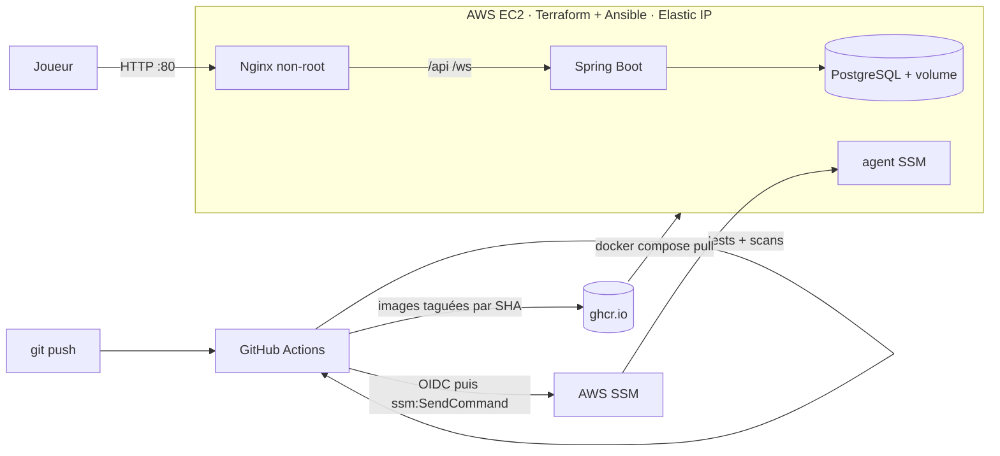

# Dhamet : jeu de dames mauritanien, déployé en continu sur AWS

[](https://github.com/mohamed22007/PRJ_deployement/actions/workflows/ci.yml)
[](https://github.com/mohamed22007/PRJ_deployement/actions/workflows/security.yml)

**Dhamet** (Zamma) est un jeu de dames mauritanien multijoueur en temps réel : création de parties, code d'invitation, chat en partie, messagerie entre joueurs, classement et historique.

Au-delà de l'application, ce dépôt est un **projet DevOps / DevSecOps complet**. Chaque `git push` sur `main` est testé, scanné, empaqueté en images Docker, puis déployé automatiquement sur AWS, sans clé stockée et sans port SSH ouvert à la CI.

**Démo :** http://13.36.196.196

| Couche | Technologies |
|---|---|
| Application | Spring Boot 3.5 (Java 17) · Angular 21 (zoneless) · PostgreSQL 15 · WebSocket STOMP |
| Conteneurs | Docker multi-stage, non-root · Docker Compose · Nginx (reverse proxy) |
| CI/CD | GitHub Actions · GitHub Container Registry (GHCR) |
| Infrastructure | Terraform (AWS EC2, IAM, Security Group, Elastic IP) · Ansible |
| Déploiement | OIDC GitHub → AWS · AWS Systems Manager (SSM) |
| Sécurité | Gitleaks · Checkov · Trivy · Dependabot |

---

## Architecture



- **Nginx est la seule porte d'entrée.** Il sert Angular et transmet `/api` et `/ws` au backend. Le backend et la base ne sont jamais exposés.
- **Le serveur ne compile rien.** La CI construit les images une seule fois, et le serveur ne fait que les télécharger (`docker compose pull`).
- **La même image est testée puis livrée.** Elle est taguée par le SHA du commit, ce qui rend le rollback immédiat.

---

## Lancer le projet en local

Prérequis : Docker avec le plugin Compose.

```bash
cp .env.example .env      # puis change DB_CODE
make run                  # construit et démarre db + backend + frontend
make smoke                # vérifie que le site et /actuator/health répondent
```

L'application est alors sur http://localhost.

| Commande | Effet |
|---|---|
| `make test` | Tests backend (`mvn test`) + frontend (`ng test`) |
| `make logs` | Logs de tous les conteneurs |
| `make stop` | Arrête la stack (la base est conservée) |
| `make clean` | Arrête et supprime les images locales **et le volume de la base** |

---

## Pipeline CI/CD

Deux workflows tournent à chaque push et à chaque pull request :

| Workflow | Jobs | Rôle |
|---|---|---|
| [`ci.yml`](.github/workflows/ci.yml) | `test` → `build` → `smoke-test` → `deploy` | 63 tests backend + 35 tests frontend. Puis images poussées sur GHCR, stack démarrée et testée, et enfin déploiement en production (`main` uniquement) |
| [`security.yml`](.github/workflows/security.yml) | `gitleaks` · `checkov` · `trivy` (backend, frontend) | Secrets, mauvaises configurations IaC et CVE dans les images. Résultats publiés dans l'onglet Security (SARIF). Relancé chaque lundi |

Sur une pull request, rien n'est poussé ni déployé : du code non relu n'arrive jamais en production.

### Déploiement sans clé ni SSH

1. Le job `deploy` demande à GitHub un **jeton OIDC** signé (`permissions: id-token: write`).
2. AWS STS vérifie le jeton et la *trust policy* du rôle `prj-github-deploy`. Seul l'environnement `production` de ce dépôt est accepté, avec le sujet immuable (IDs du compte et du dépôt).
3. STS renvoie des identifiants **temporaires** (1 h). Ils ne permettent que `ssm:SendCommand` sur **cette** instance, avec le document `AWS-RunShellScript`.
4. L'agent SSM de l'EC2 exécute `docker compose pull && up -d` avec le tag du commit. La CI attend le statut `Success`, puis lance un smoke test sur l'IP publique.

Aucun secret AWS n'est stocké dans GitHub, et chaque déploiement est journalisé dans *Systems Manager → Run Command*.

**Rollback :** redéployer un SHA précédent (`TAG=<sha> docker compose up -d`). L'image est déjà dans GHCR, donc rien n'est recompilé.

---

## Infrastructure as Code

```
infra/
├── terraform/   # EC2 t3.micro (eu-west-3), Security Group, Elastic IP, rôles IAM, OIDC
└── ansible/     # installe Docker, swap, /opt/prj, .env (0600), démarre la stack
```

```bash
cd infra/terraform
terraform init
terraform plan            # toujours relire les "-/+" (remplacement) avant d'appliquer
terraform apply

cd ../ansible
ansible-playbook deploy.yml
```

Choix de sécurité :
- disque chiffré ;
- IMDSv2 obligatoire (protection SSRF) ;
- SSH limité à l'IP de l'administrateur (`my_ip_cidr`) ;
- sortie limitée aux ports 80 et 443 ;
- `lifecycle { ignore_changes = [ami] }`, pour qu'une nouvelle image Ubuntu ne recrée jamais le serveur.

Fichiers jamais commités : `terraform.tfstate`, `terraform.tfvars`, `inventory.ini`, `.env`, clés.

---

## Sécurité (DevSecOps)

| Outil | Ce qu'il vérifie | État |
|---|---|---|
| Gitleaks | Secrets dans tout l'historique Git | ✅ 0 fuite |
| Checkov | Terraform + Dockerfiles | ✅ 5 règles corrigées, 4 exceptions justifiées |
| Trivy | CVE des images (OS + librairies Java) | ✅ 65 → 0 (2 exceptions justifiées, avec date d'expiration) |
| Dependabot | Maven, npm, Docker, Actions, Terraform | Mineures regroupées en une PR, majeures traitées à la main |

**Les exceptions sont signées dans le code, jamais désactivées globalement :**
- avec `#checkov:skip=<règle>:<justification>` dans la ressource concernée. Exemple : le port 80 est ouvert au monde parce que c'est un site public ;
- avec [`.trivyignore`](.trivyignore) et une **date d'expiration**. Exemple : deux CVE de `spring-webmvc` ne sont corrigées que dans Spring 7, et elles exigent `XsltView` ou SSE, que l'application n'utilise pas.

Autres mesures :
- conteneurs **non-root** (`spring` uid 1001, `nginx` uid 101) ;
- permissions GitHub minimales par job ;
- rôles IAM au **moindre privilège** ;
- images reconstruites sur la dernière image de base (`--pull`).

---

## Ce que j'ai appris : incidents réels et corrections

| Incident | Cause | Correction / leçon |
|---|---|---|
| Serveur recréé, nouvelle IP, **base perdue** | `aws_ami` avec `most_recent = true` : une nouvelle AMI force le remplacement, et le disque est supprimé avec l'instance | `ignore_changes = [ami]`, Elastic IP, relire les `-/+` du plan. Les données doivent vivre hors du serveur (sauvegardes) |
| `Not authorized to perform sts:AssumeRoleWithWebIdentity` | Le dépôt utilise le *sub* OIDC immuable (`owner@id/repo@id`) | Lire le format réel avec `gh api repos/<repo>/actions/oidc/customization/sub` |
| Trivy toujours rouge après `apk upgrade` | nginx vient du dépôt nginx.org, pas d'Alpine | Image `nginx-unprivileged:mainline-alpine` |
| CI rouge : `429 Too Many Requests` | Cache Maven invalidé + IP partagées limitées par Maven Central | Réessais dans `.mvn/maven.config` |
| Bouton « Rejoindre » à cliquer deux fois | Angular *zoneless* : pas de rendu après un callback HTTP | `detectChanges()` + test de non-régression |
| `AccessDenied` à la création des rôles IAM | Politique trop large ou incomplète, limite de 2 048 caractères en inline | Groupe IAM, JSON écrit à la main, conditions `iam:PolicyARN` et `iam:PassedToService` |

---

## Structure du dépôt

```
.
├── backend/            # Spring Boot : API REST, WebSocket, moteur de jeu (Zamma)
├── frontend/           # Angular 21 + nginx.conf (reverse proxy)
├── infra/terraform/    # infrastructure AWS
├── infra/ansible/      # configuration du serveur
├── .github/workflows/  # ci.yml, security.yml
├── docker-compose.yml  # db + backend + frontend
├── smoke_test.sh       # vérification après démarrage / déploiement
└── Makefile
```

---

## Améliorations prévues

- [ ] Sauvegarde quotidienne `pg_dump` vers S3 + test de restauration
- [ ] HTTPS (Let's Encrypt) et nom de domaine
- [ ] State Terraform distant (S3 + verrou)
- [ ] Migration vers Spring Boot 4 (avant l'expiration du `.trivyignore`)
- [ ] Monitoring (CloudWatch ou Prometheus / Grafana)

---

## Auteur

**Mohamed** · [github.com/mohamed22007](https://github.com/mohamed22007)
